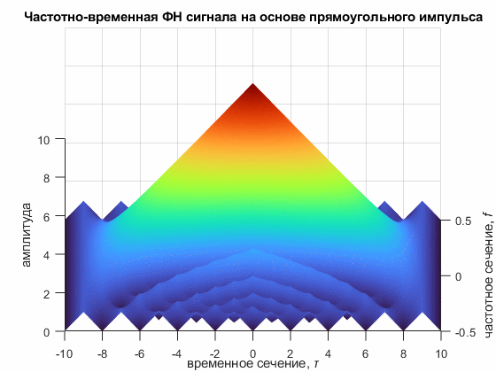

# MATLAB Spingraph


Функция MATLAB для создания анимированных GIF из 3D-графиков. Захватывает текущую фигуру и сохраняет ее вращение в GIF-файл. Поддерживает до трех последовательных вращений с разными вертикальными углами



## Возможности

- Создание анимированного GIF из любого текущего 3D-графика (`surf`, `mesh`, `plot3` и т.п.)
- Настройка диапазона, шага горизонтального вращения и задержки между кадрами
- До трех вращений с разными углами наклона (`elev1`, `elev2`, `elev3`)
- Автоматическое зацикливание GIF (`LoopCount = Inf`)

## Системные требования

- 🖥️ Windows | Linux | macOS
- 🧮 MATLAB R2014b+

## Ограничения

> [!CAUTION]
> Если файл с указанным именем уже существует, функция перезапишет его без предупреждения

> [!WARNING]
> При первом кадре используется проверка `if ang == 0`. Если диапазон `angles` не содержит `0` (например, `90:10:360`), первый кадр не будет записан с `LoopCount = Inf`, и GIF может не зацикливаться. В таких случаях начинайте диапазон с `0` или добавляйте `0` в начало

> [!WARNING]
> Функция использует `getframe` и `imwrite`. Для корректной работы окно фигуры должно быть открыто и не перекрыто другими окнами/курсором мыши во время записи.

## Установка

Скопируйте файл `spingraph.m` в директорию проекта или в любую папку, добавленную в путь MATLAB.

> [!NOTE]
> Требуется только базовый MATLAB без сторонних тулбоксов

## Синтаксис

```matlab
spingraph(filename, angles, delay, [elev1], [elev2], [elev3])
```

## Параметры

| Параметр | Описание | Пример |
|---|---|---|
| `filename` | Имя GIF-файла | `'name.gif'` |
| `angles` | Горизонтальные углы в градусах (начало:шаг:конец) | `0:10:360` |
| `delay` | Задержка между кадрами в секундах | `0.5` |
| `elev1` | Вертикальный угол 1-го вращения (по умолчанию `30`) | `30` |
| `elev2` | Вертикальный угол 2-го вращения (опционально) | `75` |
| `elev3` | Вертикальный угол 3-го вращения (опционально) | `90` |

## Использование

1. Постройте 3D-график (`surf`, `mesh`, `plot3` и т.п.)
2. Вызовите `spingraph` с нужными параметрами

### Примеры

Одно вращение с углом наклона по умолчанию

```matlab
spingraph('name.gif', 0:30:180, 1.0)
```

Два вращения

```matlab
spingraph('name.gif', 90:10:360, 0.05, 30, 75)
```

Три вращения

```matlab
spingraph('name.gif', 0:1:90, 0.1, 30, 75, 90)
```

## Демонстрация

В репозитории есть файл `demo.m`, который строит четыре графика (прямоугольный импульс, АКФ, частотная ФН и частотно-временная ФН) и сохраняет вращение 3D-графика функции неопределенности в `ambiguity.gif`

```matlab
run('demo.m')
```

## Лицензия

Проект распространяется под лицензией [BSD-3-Clause](https://github.com/lezhebokin/matlab-spingraph/blob/main/LICENSE)
